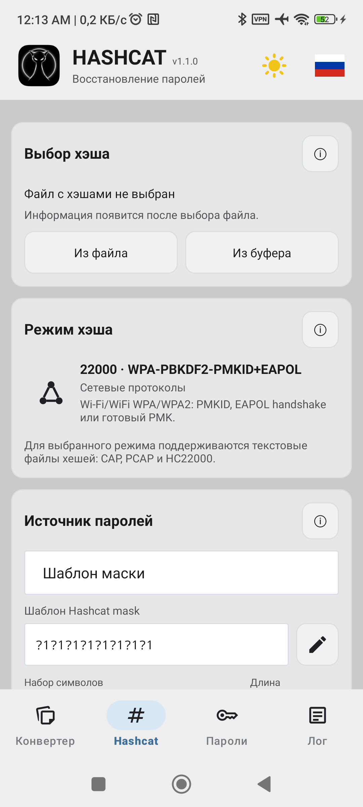
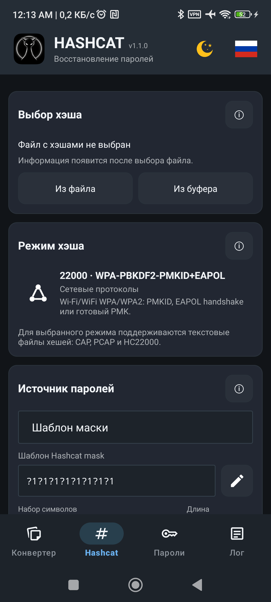

<p align="right">🌐 Language: <strong>Русский</strong> | <a href="README_EN.md">English</a></p>

# HASHCAT Android

Android-интерфейс для Hashcat, ориентированный на восстановление паролей.

Приложение запускает встроенный Hashcat непосредственно на Android, позволяет выбирать режим хэша, использовать маску или словарь, настраивать параметры выполнения, конвертировать CAP/PCAP в HC22000 и следить за прогрессом и логами.

## Возможности

- Запуск Hashcat непосредственно на Android.
- Выбор режима хэша с описанием.
- Атаки по маске и словарю.
- Поддержка CAP, PCAP и HC22000 для режима 22000.
- Загрузка хэшей из файла или буфера обмена.
- Конвертация CAP/PCAP в HC22000.
- Настройка лимита памяти, нагрузки GPU и оптимизированного ядра.
- Отображение прогресса, скорости, найденных паролей и логов.
- Русский и английский интерфейс.
- Светлая и тёмная темы.

## Скриншоты

### Светлая тема



### Тёмная тема



## Сборка

```powershell
.\gradlew.bat :app:assembleDebug
```

Debug APK:

```text
app/build/outputs/apk/debug/app-debug.apk
```