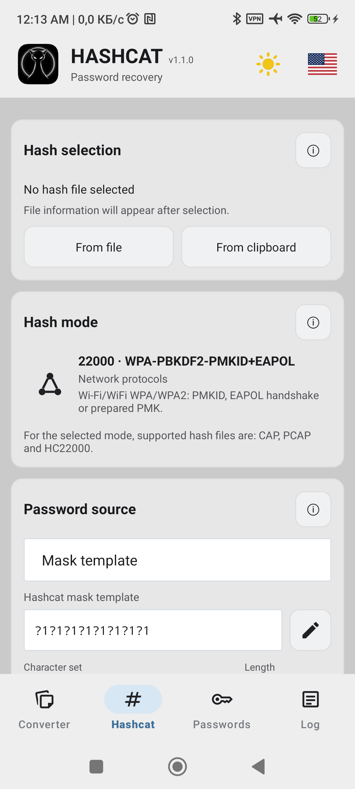
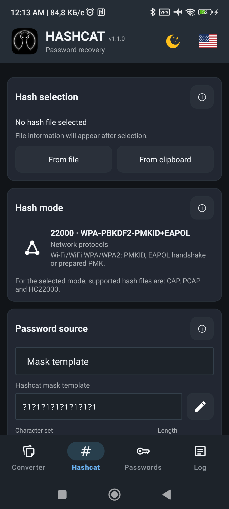

<p align="right">🌐 Language: <a href="README.md">Русский</a> | <strong>English</strong></p>

# HASHCAT Android

Android interface for Hashcat focused on password recovery workflows.

The application runs the bundled Hashcat runtime on Android, provides hash-mode selection, mask or wordlist attacks, runtime tuning, CAP/PCAP conversion to HC22000, live status and logs.

## Features

- Hashcat execution directly on Android.
- Hash mode selection with mode descriptions.
- Mask and wordlist candidate sources.
- CAP, PCAP and HC22000 input support for mode 22000.
- Hash input from a file or the clipboard.
- CAP/PCAP to HC22000 converter.
- Memory limit, GPU workload and optimized-kernel controls.
- Live progress, speed, recovered count and logs.
- English and Russian interface.
- Light and dark themes.

## Screenshots

<table>
  <tr>
    <td align="center"><strong>Light theme</strong></td>
    <td align="center"><strong>Dark theme</strong></td>
  </tr>
  <tr>
    <td></td>
    <td></td>
  </tr>
</table>

## Build

```powershell
.\gradlew.bat :app:assembleDebug
```

Debug APK:

```text
app/build/outputs/apk/debug/app-debug.apk
```